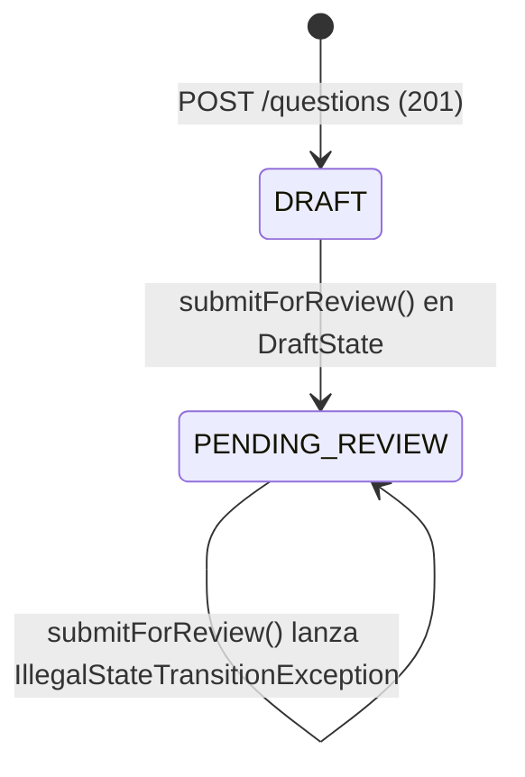
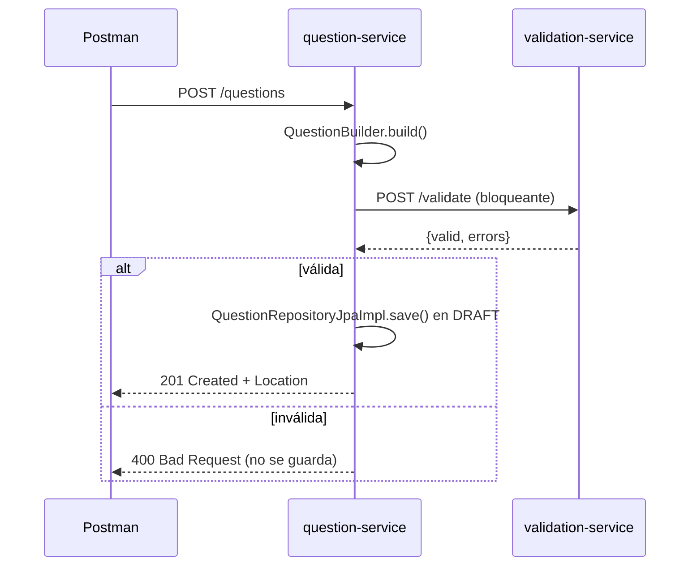

# Laboratorio de Ingeniería de Software II — Parcial Práctico Corte 2
## Builder y State, Comunicación REST/AMQP y Persistencia JPA Limpia

- **Institución:** Universidad del Cauca  
- **Facultad:** Facultad de Ingeniería Electrónica y Telecomunicaciones (FIET)  
- **Programa:** Ingeniería de Sistemas  
- **Asignatura:** Laboratorio de Ingeniería de Software II  
- **Docente:** Ing. Paola Andrea Bedoya Toro  
- **Periodo Académico:** 2026.2  
- **Autores**  
  - Adrián Camilo Araujo Urbano  

---

## 1. Introducción y Objetivo

El parcial integra en una arquitectura de microservicios tres componentes: la creación estructurada de reactivos y su ciclo de vida con patrones GoF (Punto 1, 30 %), la comunicación síncrona REST y asíncrona con RabbitMQ (Punto 2, 40 %) y la persistencia limpia con Spring Data JPA sobre H2 (Punto 3, 30 %).

El código está en la carpeta `parcial-corte2/` y sigue las mismas convenciones de `microservicios/` (Taller 09) y del módulo JPA limpio de `banco-preguntas/` (Taller 10): `shared-contracts` con DTOs y constantes, paquetes `client`, `config`, `controller`, `application`, `domain`, Swagger en cada servicio, `QuestionException` con el código HTTP y `ApiExceptionHandler`.

---

## 2. Arquitectura y Delimitación de Responsabilidades

| Microservicio | Puerto | Responsabilidad |
|---|---|---|
| `validation-service` | 8082 | `POST /validate`: la justificación debe tener más de 15 caracteres (patrón Strategy). |
| `question-service` | 8083 | Construye la pregunta con Builder, valida síncronamente con RestTemplate, persiste con JPA en H2 y publica el comando en RabbitMQ. |
| `lifecycle-service` | 8084 | Consume `SubmitQuestionForReview` con `@RabbitListener` y aplica la transición con el patrón State. |
| `shared-contracts` | — | `CreateQuestionRequest`, `ValidationResult`, `SubmitQuestionForReview`, `RabbitMQConstants`. |

```mermaid
flowchart LR
    P[Postman] -->|POST /questions| Q[question-service :8083]
    Q -->|POST /validate · RestTemplate| V[validation-service :8082]
    Q -->|JPA| H[(H2 question_db)]
    P -->|POST /questions/id/submit| Q
    Q -->|SubmitQuestionForReview · rk question.submit| X{{saberpro.direct.exchange}}
    X --> C[[question.submit.review.queue]]
    C -->|@RabbitListener| L[lifecycle-service :8084]
    C -.tras 3 reintentos.-> D[[question.submit.review.queue.dlq]]
```

### 2.1 Estructura de `question-service`

```
questionservice/
├── domain/
│   ├── model/        Question, AnswerOption, QuestionStatus        (Java puro, Punto 3.1)
│   ├── builder/      IQuestionBuilder, QuestionBuilder             (Punto 1.1)
│   ├── repository/   QuestionRepository                            (puerto de persistencia)
│   ├── port/         StructuralValidator, ReviewRequestPublisher
│   └── QuestionException
├── application/      QuestionAuthoringFacade                       (Facade)
├── client/           ValidationClient (Adapter REST), RabbitReviewRequestPublisher
├── config/           RabbitMQConfig, AppConfig (RestTemplate con timeouts)
├── controller/       QuestionController, ApiExceptionHandler
└── infrastructure/jpa/
    ├── record/       QuestionRecord, AnswerOptionRecord            (Punto 3.2)
    ├── mapper/       QuestionDomainMapper                          (Punto 3.3)
    └── repository/   SpringQuestionDataRepository, QuestionRepositoryJpaImpl (Punto 3.3)
```

---

## 3. Punto 1 — Patrones de Diseño GoF

### 3.1 Builder (`question-service/.../domain/builder`)

`IQuestionBuilder` define la interfaz fluida (`statement`, `justification`, `author`, `option`, `correctOption`, `build`) y `QuestionBuilder` la implementa. `build()` valida **antes** de instanciar el objeto de dominio:

- enunciado y justificación obligatorios;
- exactamente 4 opciones, cada una con letra y texto;
- letras y textos sin repetir;
- la respuesta correcta coincide con exactamente una opción.

Si algo falla lanza `QuestionException.invalid(errores)` (HTTP 400) con **todos** los errores juntos. El constructor de `Question` es privado: no hay forma de crear una pregunta nueva sin pasar por el builder.

### 3.2 State (`lifecycle-service/.../domain/state`)



`QuestionLifecycle` (contexto) delega en `IQuestionState`; `DraftState` cambia a `PendingReviewState` y `PendingReviewState` rechaza el reenvío. No hay `if/else` ni `switch`: la transición se resuelve por polimorfismo. `transitionTo()` es *package-private*, así que solo las clases State pueden cambiar el estado.

> El State vive en `lifecycle-service` porque el enunciado indica que es ese microservicio el que efectúa la transición a `PENDING_REVIEW`, igual que en el Taller 09 (lifecycle-service es la autoridad del estado).

---

## 4. Punto 2 — Comunicación entre Microservicios

### 4.1 Flujo síncrono (Punto 2.1)



`ValidationClient` usa `RestTemplate` con timeouts de 2 s (conexión) y 3 s (lectura). Si validation-service no responde se devuelve **503** y tampoco se guarda nada.

### 4.2 Flujo asíncrono (Punto 2.2)

1. `POST /questions/{id}/submit` → `QuestionAuthoringFacade` genera un `operationId` (UUID).
2. `RabbitReviewRequestPublisher` publica `SubmitQuestionForReview` en `saberpro.direct.exchange` con routing key `question.submit`.
3. Se responde **202 Accepted** de inmediato con el `operationId`.
4. `QuestionSubmitConsumer` (`@RabbitListener` en `question.submit.review.queue`) llama a `LifecycleService`, que aplica `DraftState → PendingReviewState`.
5. El resultado se consulta en `GET :8084/lifecycle/operations/{operationId}`.

Robustez: el consumo es idempotente por `operationId`, los errores de negocio quedan `FAILED` sin reintentar, y las fallas inesperadas tienen 3 reintentos antes de ir a la DLQ. Exchange, cola y binding se declaran en ambos servicios con los mismos argumentos, así no se pierden mensajes si question-service publica antes de que lifecycle-service arranque.

---

## 5. Punto 3 — Persistencia JPA Limpia

| Elemento | Implementación |
|---|---|
| Dominio puro (3.1) | `domain.model.Question` y `AnswerOption` sin `@Entity`, `@Table` ni `@Id`. `DominioPuroTest` lo verifica por reflexión. |
| Modelo relacional (3.2) | `QuestionRecord` (`questions`) con `@OneToMany(mappedBy = "question", cascade = CascadeType.ALL, orphanRemoval = true)` hacia `AnswerOptionRecord` (`answer_options`, FK `question_id`). |
| Mapeador (3.3) | `QuestionDomainMapper.toRecord()` y `toDomain()`. |
| Repositorio (3.3) | `QuestionRepositoryJpaImpl implements QuestionRepository` e inyecta `SpringQuestionDataRepository`. |

Esquema generado en H2:

```
QUESTIONS (id PK, question_text, justification_text, author_id, status)
ANSWER_OPTIONS (id PK, option_label, option_text, is_correct, question_id FK -> QUESTIONS.id)
```

---

## 6. Matriz de Pruebas (Rúbrica de Evaluación)

| # | Prueba | Resultado esperado | Criterio |
|---|---|---|---|
| 1 | `POST :8083/questions` válida | 201 + `status: DRAFT` | Builder, REST, JPA |
| 2 | Justificación de 15 caracteres o menos | 400, no se guarda | REST síncrono |
| 3 | Solo 3 opciones | 400 (Builder) | Builder |
| 4 | Respuesta correcta inexistente | 400 (Builder) | Builder |
| 5 | `GET :8083/questions` | Solo la pregunta válida | JPA en H2 |
| 6 | `POST :8083/questions/{id}/submit` | 202 + `operationId` | AMQP |
| 7 | `GET :8084/lifecycle/operations/{operationId}` | `COMPLETED` | `@RabbitListener` |
| 8 | `GET :8084/lifecycle/{id}` | `PENDING_REVIEW` | State |
| 9 | Reenviar y consultar la operación | `FAILED` | State sin condicionales |
| 10 | `POST :8083/questions/9999/submit` | 404 | Manejo de errores |

Pruebas automatizadas (`mvn test`): `QuestionBuilderTest`, `DominioPuroTest`, `QuestionAuthoringFacadeTest`, `QuestionRepositoryJpaImplH2Test` (`@DataJpaTest`), `QuestionStateTest`, `LifecycleServiceTest` y `QuestionValidatorTest`.

---

## 7. Instrucciones de Ejecución

### 7.1 Requisitos previos
JDK 21, Docker Desktop y Postman. Se usa el Maven Wrapper de la raíz del repositorio.

### 7.2 Opción rápida (Windows)
```powershell
cd parcial-corte2
.\start-all.ps1
```
Para detener: `.\stop-all.ps1`.

### 7.3 Paso a paso
```powershell
cd parcial-corte2
docker compose up -d
..\mvnw.cmd clean install

# Terminal 1 - Lifecycle Service (:8084)
cd lifecycle-service;  ..\..\mvnw.cmd spring-boot:run
# Terminal 2 - Validation Service (:8082)
cd validation-service; ..\..\mvnw.cmd spring-boot:run
# Terminal 3 - Question Service (:8083)
cd question-service;   ..\..\mvnw.cmd spring-boot:run
```

> Si el RabbitMQ del Taller 09 (`rabbitmq-taller09`) está encendido, ocupa los mismos puertos: se puede usar ese mismo broker (los nombres de exchange y cola no chocan) o detenerlo antes de `docker compose up`.

### 7.4 Evidencias
- **Postman:** importar `parcial-corte2/lisw2_parcial2_postman_collection.json` y ejecutarla con el Collection Runner, en orden.
- **RabbitMQ:** http://localhost:15672 → *Exchanges → saberpro.direct.exchange* (binding `question.submit`) y *Queues → question.submit.review.queue*.
- **H2:** http://localhost:8083/h2-console, JDBC URL `jdbc:h2:mem:question_db`, usuario `sa`.
- **Swagger:** `http://localhost:808X/swagger-ui.html` en cada servicio.

---

## 8. Justificación Técnica para Sustentación

- **¿Por qué el State no usa if/switch?** Porque cada estado es una clase y el contexto llama `state.submitForReview(this)`; Java decide en tiempo de ejecución qué implementación corre (despacho dinámico). Agregar un estado es agregar una clase (principio abierto/cerrado).
- **¿Por qué 202 y no 200?** Porque al responder la transición aún no ha ocurrido: la solicitud fue *aceptada* y se procesa después en lifecycle-service. El `operationId` permite consultar el resultado.
- **¿Por qué validation-service responde 200 aunque la pregunta sea inválida?** "Inválida" es un resultado de negocio, no un error del protocolo. Quien traduce a 400 para el cliente final es question-service.
- **¿Por qué separar `Question` de `QuestionRecord`?** Para que el dominio no dependa de JPA: se puede cambiar H2 por PostgreSQL o JPA por JDBC tocando solo `infrastructure`, sin modificar reglas de negocio ni pruebas de dominio.
- **¿Por qué `mappedBy` y `cascade = ALL`?** `mappedBy` indica que la FK la tiene `AnswerOptionRecord` (lado dueño); `cascade` hace que al guardar la pregunta se guarden sus 4 opciones en la misma operación.
